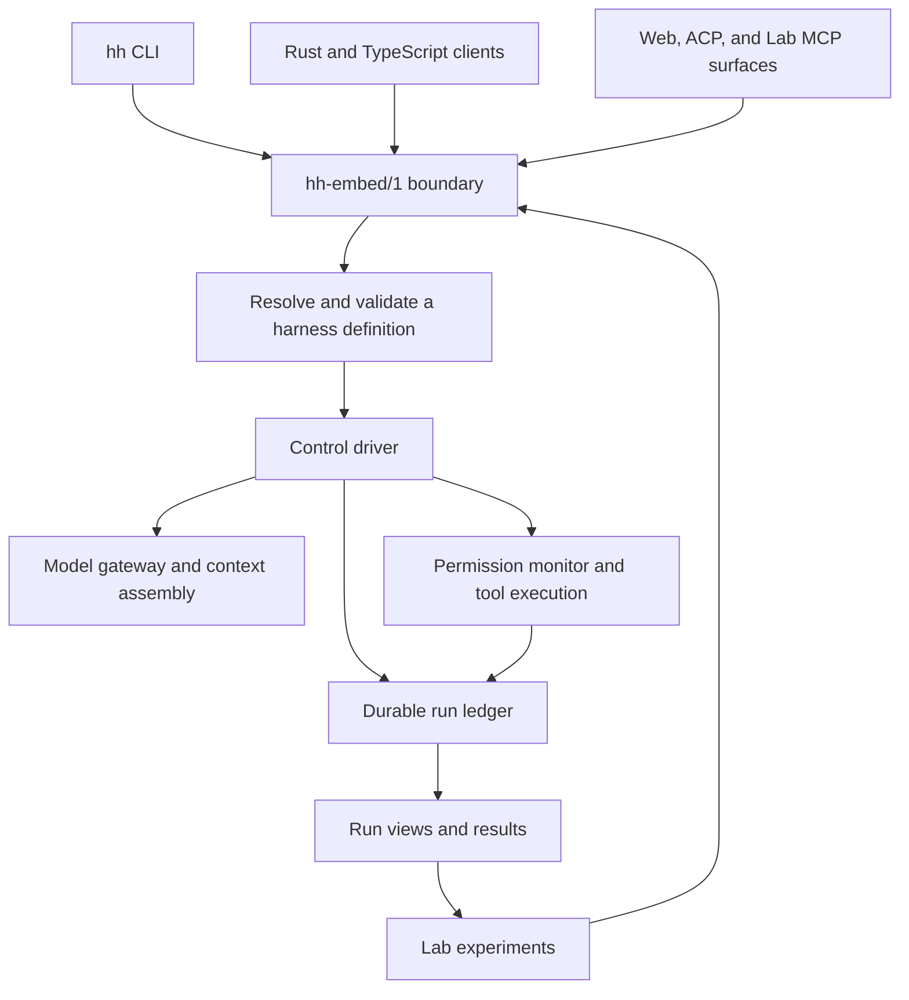

# Architecture and concepts

HarnessHarness combines an agent runtime with a laboratory for comparing
harness designs. A **harness** is the machinery around a model: how it receives
context, chooses actions, uses tools, spends resources, and decides when to stop.
The runtime records those decisions; the Lab uses the records to compare runs
and configurations.

Start with [Getting started](getting-started.md) to run the example, or
[Interfaces and configuration](reference.md) to integrate a client.

## The system at a glance

This diagram shows responsibilities and data flow. The Cargo dependency graph
has more detail; the [crate map](../crates/AGENTS.md) locates each package.

## Definitions, runs, and sessions

A **definition** describes a harness as a JSON document in **HIR/1**, the Harness
Intermediate Representation. Its nodes describe entities such as the agent,
budget, permissions, and rules. Its `assembly` section selects component
variants and their parameters. The checked-in
[example definition](../clients/ts/fixture-definition.json) contains a small
working configuration.

The assembly layer resolves references and validates composition. Sealing gives
the resolved definition a content identity. The compiler can lower a sealed
definition into a **RuntimePlan/1** and model/tool interface descriptions, with
trace information linking outputs back to the definition. These outputs are
data interpreted by the runtime.

A **run** is one execution with its own manifest and ledger. A **session** is a
client's connection to that run: it can open a new run, resume one, or attach
for inspection. A read-only attachment takes no writer lease. Run identifiers
persist with the store; session identifiers belong to the service process that
created them.

## One boundary for clients

`hh-embed/1` is the typed client/kernel protocol. It has three bindings:

| Binding | Entry point | Typical use |
|---|---|---|
| In process, called **(a)** in the specification | `EmbedService::handle` | Embed the kernel in a Rust application or test |
| Standard input/output, **(b)** | `hh-kernel serve` | The `hh` CLI and child-process clients |
| Loopback HTTP, **(c)** | `hh-kernel serve --http` | Local clients, including the generated TypeScript client |

Both transport implementations call the same service dispatcher. The CLI maps
commands to protocol operations and renders results; authorization, budgets,
and run semantics belong to the kernel. Clients negotiate the contract and
schema identity through `hello`.

The separate `hh-mcp-serve` binary serves compiled MCP artifacts without a
kernel connection. Its catalog-serving role differs from `hh lab serve`, which
exposes Lab operations. See [MCP execution and compatibility limits](status.md#replay-and-client-compatibility).

The [schema source](../crates/hh-embed-schema/src/lib.rs) defines the protocol.
[Code generation](../crates/hh-codegen/src/main.rs) produces the checked-in
schema exports and clients. For transport details, see
[the interface reference](reference.md#kernel-bindings).

## Decisions and durable state

The control driver receives cues, asks the configured strategy for a decision,
checks the runtime envelope, and executes admitted work. The envelope applies
constraints such as budget and stop rules. Tool effects pass through resolution,
authorization, preparation, commitment, execution, capture, and observation.
The permission monitor owns authorization; the executor carries out admitted
effects.

The **run ledger** is the authoritative record of what the runtime decided,
did, and observed. It is an append-only, hash-chained event log with a fenced
writer lease. Durable batches are written and synchronized before they become
visible to readers. A stale writer cannot continue appending after takeover.

Run views and Lab results derive from recorded inputs. A results projection
pins the run prefix it read and verifies that prefix before building a row.
This makes it possible to inspect the evidence behind a result and rebuild
views from the record.

**Replay** re-drives recorded behavior under the replay contract. It is distinct
from calling the model again or re-executing external effects. The
[status guide](status.md#replay-and-client-compatibility) explains the scope of
the current replay evidence and client compatibility limits.

## The Lab

The Lab provides experiment definitions, scheduling, results, evaluation,
analysis, and benchmark records. Experiments expand configurations and tasks
into planned cells; their lifecycle and results retain references to the runs
that produced them. The included
[experiment exemplars](../crates/hh-lab/src/exemplars.rs) cover compaction and
control-strategy comparisons.

Hosted participants connect through `hh-hosting/1`, which exchanges records
and declares observable capabilities. The hosting boundary distinguishes what
an external participant actually exposes from what the native runtime can
observe. Plugins use a separate `plugin_abi/1` boundary through the variant
host and helper process.

## Where the code lives

Directory names use `hh-*`; Cargo package names usually use `hharness-*`.
For example, `crates/hh-ledger` contains package `hharness-ledger`.

| Responsibility | Source entry points |
|---|---|
| Canonical JSON, identities, shared vocabulary and provenance | [wire](../crates/hh-wire/src/lib.rs), [identity](../crates/hh-identity/src/lib.rs), [ontology](../crates/hh-ontology/src/lib.rs), [provenance](../crates/hh-provenance/src/lib.rs) |
| Definitions and composition | [HIR](../crates/hh-hir/src/lib.rs), [assembly](../crates/hh-assembly/src/lib.rs), [compiler](../crates/hh-compiler/src/lib.rs) |
| Durable state | [ledger](../crates/hh-ledger/src/lib.rs) |
| Runtime decisions | [control](../crates/hh-control/src/lib.rs), [budget](../crates/hh-budget/src/lib.rs), [context](../crates/hh-context/src/lib.rs) |
| Models and actions | [gateway](../crates/hh-gateway/src/lib.rs), [monitor](../crates/hh-monitor/src/lib.rs), [environment](../crates/hh-env/src/lib.rs), [helper](../crates/hh-helper/src/lib.rs) |
| Kernel boundary and CLI | [embed](../crates/hh-embed/src/lib.rs), [kernel](../crates/hh-kernel/src/main.rs), [CLI](../crates/hh-cli/src/lib.rs) |
| Experiments and evidence | [Lab schemas](../crates/hh-lab/src/lib.rs), [experiment engine](../crates/hh-experiment/src/lib.rs), [results](../crates/hh-results/src/lib.rs), [hosting](../crates/hh-hosting/src/lib.rs) |
| Extensions and cross-implementation checks | [plugin manifests](../plugins/), [variant host](../crates/hh-varhost/src/lib.rs), [replay checker](../crates/hh-xcheck/CHECKER.md) |

The workspace keeps a deliberately narrow external dependency set. Cryptography
and TLS have named, pinned admissions; the exact rules are in
[Contributing](../CONTRIBUTING.md). The full behavioral contract lives in the
[frozen specification](../spec/CANONICAL_SPEC.md), with later decisions in the
[ADR index](adr/README.md). The specification's **C0–C5** labels describe feature
maturity tiers; they are not release versions or operational readiness ratings.
